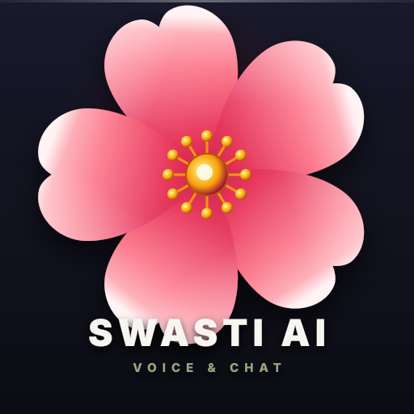

# Swasti 🌸 — 100% Private Offline AI Voice & Chat Companion


<div align="center">



### **Created & Developed by Bikash Talukder**

*An ultra-realistic, fully private, offline voice and chat web application powered by local LLMs (Ollama), Kokoro-82M ONNX neural speech synthesis, and faster-whisper speech recognition.*

[](https://react.dev/)
[](https://www.typescriptlang.org/)
[](https://tailwindcss.com/)
[](https://fastapi.tiangolo.com/)
[](https://github.com/thewh1teagle/kokoro-onnx)
[](https://github.com/SYSTRAN/faster-whisper)
[](https://ollama.ai/)
[](https://web.dev/progressive-web-apps/)

</div>

---

## 🌟 Overview


**Swasti 🌸** is designed from the ground up for individuals who demand complete privacy, uncompromising speed, and lifelike natural human voice interactions without sending a single byte of audio or chat data to external servers.

Running entirely on your local machine (macOS / Linux / Windows):
1. **Local LLM Engine**: Connects directly to [Ollama](https://ollama.ai) (`http://127.0.0.1:11434` or local network LAN IP) with streaming responses.
2. **Neural Speech Synthesis (TTS)**: Powered by **Kokoro-82M ONNX**, generating warm, expressive, ultra-realistic human voices with near-zero latency.
3. **Local Speech Recognition (STT)**: Powered by **faster-whisper** for instant, accurate audio-to-text transcription.
4. **Editorial Typography & Visual Taste**: Built with modern luxury fonts (**Plus Jakarta Sans**, **Playfair Display**, **JetBrains Mono**), responsive collapsible layout, and 3 active multi-color palettes.

---

## ✨ Core Features

### 👩‍💼 Personal Persona — Swasti 🌸
- Configured with a dedicated identity: intelligent, elegant, articulate, and thoughtful.
- Proudly acknowledges its creator: **Bikash Talukder**.
- Answers with structured explanations, LaTeX derivations, and clear formatting.

### 🎙️ Ultra-Realistic Voice & Interactive Voice Mode
- **14+ Voice Profiles**: From warm conversational American (*Swasti 🌸 Natural* / `af_heart`) to refined British accents (*Swasti 🌸 Emma* / `bf_emma`) and deep baritones (*Swasti 🌸 Adam* / `am_adam`).
- **Interactive Voice Mode**: Fullscreen modal with a dynamic audio visualizer orb reacting live to microphone input and speech frequencies.
- **Natural Voice Interruption**: Start speaking at any time to automatically pause Swasti 🌸's speech output.

### ⚡ Smooth Word-by-Word Streaming Animation
- 60fps token queue ensures responses flow steadily and comfortably onto the screen without jarring bulk text dumps.

### 📐 KaTeX Math, Tables & Vibrant Code Highlighting
- **LaTeX KaTeX**: Renders inline equations (`$E=mc^2$`) and block math (`$$\int_{-\infty}^{\infty} e^{-x^2} dx = \sqrt{\pi}$$`).
- **Vivid Code Highlighting**: Prism.js engine with custom syntax tokens for C++, Python, JavaScript, TypeScript, Bash, Rust, Go, SQL, HTML, and JSON.
- **Mac-Style Code Headers**: Clean top bar with language badge and 1-click copy with feedback.

### 🎨 3 Active Color Palettes (All 3 Colors Active in Light & Dark Modes)
1. **Sage & Tomato**: Primary Sage (`#9CAF88`), Base Off-White (`#F7F5EF`), Accent Tomato Red (`#E8412C`).
2. **Mocha & Rose Gold**: Primary Mocha Taupe (`#5E4B42`), Base Soft Nude (`#F2E4DA`), Accent Rose Gold (`#B87866`).
3. **Nordic Teal & Peach**: Primary Deep Teal (`#0F3D47`), Base Ice White (`#F4F8FA`), Accent Soft Peach (`#F59E7B`).
- **Cohesive Light Mode**: A genuine light background matching the active palette with perfect surface contrast.

### 📑 ChatGPT / Claude-Style Collapsible Sidebar
- Smooth desktop and mobile collapsible transitions.
- Chronological session grouping: *Today*, *Yesterday*, *Previous 7 Days*, and *Older*.
- Real-time search filter, inline session renaming, deletion, and 1-click Markdown (`.md`) export.
- Quick keyboard shortcut: <kbd>⌘K</kbd> / <kbd>Ctrl+K</kbd> to start a new chat.

---

## 🏗️ Architecture

```mermaid
flowchart LR
    subgraph Browser["Frontend (React 19 + Vite)"]
        UI["Swasti UI / ChatArea"]
        STT_Hook["useSpeechToText"]
        TTS_Hook["useTextToSpeech"]
        Ollama_Hook["useOllama"]
    end

    subgraph Backend["Local Python Voice Server (FastAPI)"]
        WhisperEngine["faster-whisper (CPU / int8)"]
        KokoroEngine["Kokoro-82M ONNX + Voices"]
    end

    subgraph LocalLLM["Ollama Service"]
        LLM["Ollama Engine (e.g. LLaMA 3.2, Mistral, Qwen)"]
    end

    UI -->|Audio Blob| STT_Hook
    STT_Hook -->|POST /transcribe :5005| WhisperEngine
    WhisperEngine -->|JSON Text| STT_Hook
    STT_Hook --> UI

    UI -->|Chat History & System Prompt| Ollama_Hook
    Ollama_Hook -->|POST /api/chat :11434| LLM
    LLM -->|Tokens Streaming (60fps)| UI

    UI -->|Response Text| TTS_Hook
    TTS_Hook -->|POST /speak :5006| KokoroEngine
    KokoroEngine -->|WAV Audio Buffer| TTS_Hook
    TTS_Hook --> UI
```

---

## 📋 Prerequisites

Before starting, ensure you have the following installed on your system:

1. **Python 3.10+**: `python3 --version`
2. **Node.js 18+ & npm**: `node --version`
3. **Ollama**: Installed and running locally:
   ```bash
   # Start Ollama
   ollama serve

   # Pull your preferred local model
   ollama pull llama3.2
   ```

---

## 🚀 2 Simple Commands: Start & Stop

Control the entire application (Voice Server + Web App) with just two commands:

### 1️⃣ Start Swasti 🌸:
```bash
./start.sh
# or: npm start
```
*Automatically sets up virtualenv, downloads models if missing, and starts both the Voice Server and Web UI at **[http://localhost:5173](http://localhost:5173)**.*

### 2️⃣ Stop Swasti 🌸:
```bash
./stop.sh
# or: npm stop
```
*Cleanly stops all background services and frees ports 5005, 5006, and 5173.*

---

## 🛠️ Manual Step-by-Step Setup

If you prefer starting the backend and frontend separately:

### 1. Backend Voice Server Setup

```bash
# Create and activate virtual environment
python3 -m venv .venv
source .venv/bin/activate

# Install dependencies
pip install -r requirements.txt

# Download Kokoro ONNX model weights (~330MB total)
python download_models.py

# Start the Voice Server
python voice_server.py
```
*Voice server health check:* `curl http://localhost:5005/health`

### 2. Frontend Web App Setup

```bash
# Install node dependencies
npm install

# Start Vite development server
npm run dev
```

Visit **http://localhost:5173** in Google Chrome or any modern browser.

---

## 📡 API Reference (Voice Server)

| Endpoint | Method | Description | Request Payload | Response |
| :--- | :--- | :--- | :--- | :--- |
| `/health` | `GET` | Health check & model readiness | None | `{"status": "online", "stt": {...}, "tts": {...}}` |
| `/voices` | `GET` | List all available voice profiles | None | List of voices with names, accents, and IDs |
| `/transcribe` | `POST` | Transcribe speech audio to text | `multipart/form-data` with `file` | `{"text": "...", "duration": 2.1, "latency": 0.42}` |
| `/speak` | `POST` | Synthesize text into natural WAV audio | `{"text": "...", "voice": "af_heart", "speed": 1.0}` | `audio/wav` stream |

---

## ⌨️ Keyboard Shortcuts

| Shortcut | Action |
| :--- | :--- |
| <kbd>⌘K</kbd> / <kbd>Ctrl+K</kbd> | Open a brand new conversation |
| <kbd>Enter</kbd> | Send current prompt to Swasti 🌸 |
| <kbd>Shift + Enter</kbd> | Insert a newline into the message input box |

---

## 📱 Progressive Web App (PWA) & Native Installation

Swasti 🌸 is fully installable as an offline Progressive Web App with cross-platform icon support (Mac, iOS, Android, and Windows):
- **Smart Install Recommendation Banner**: Intelligently recommends installation when visiting the app, with 1-click prompt on Chromium/Android and step-by-step guidance for iOS Safari and macOS Sonoma.
- **Cross-Platform Vector & Raster Icons**: Features the sakura flower 🌸 with the **Swasti AI** brand typography across `favicon.svg`, `pwa-192x192.png`, `pwa-512x512.png`, and `apple-touch-icon.png`.
- **Offline Service Worker**: Instant offline loading and caching for standalone app performance.

---

## ⚡ 1-Click Vercel Deployment

Swasti 🌸 is pre-configured with `vercel.json` for seamless continuous deployment:
- **Instant CI/CD**: Every push to GitHub triggers an automatic production build and deployment on Vercel.
- **SPA Routing**: Full client-side rewrite handling for `/index.html`.
- **Security & Cache Headers**: Includes strict origin and immutable asset caching for maximum web performance.

---

## 🛡️ Privacy Guarantee

- **Zero Cloud Tracking**: All prompt text, system prompts, chat history, and generated audio remain on your device.
- **Zero External Telemetry**: No third-party analytical scripts or remote APIs are invoked during conversations.

---

## 👨‍💻 Author & Developer

**Bikash Talukder**
- GitHub: [@bikash-20](https://github.com/bikash-20)
- Repository: [LOCAL_LLM_STT_TTS_UI](https://github.com/bikash-20/LOCAL_LLM_STT_TTS_UI)

---

## 📄 License

This project is open-source and available under the **MIT License**.
